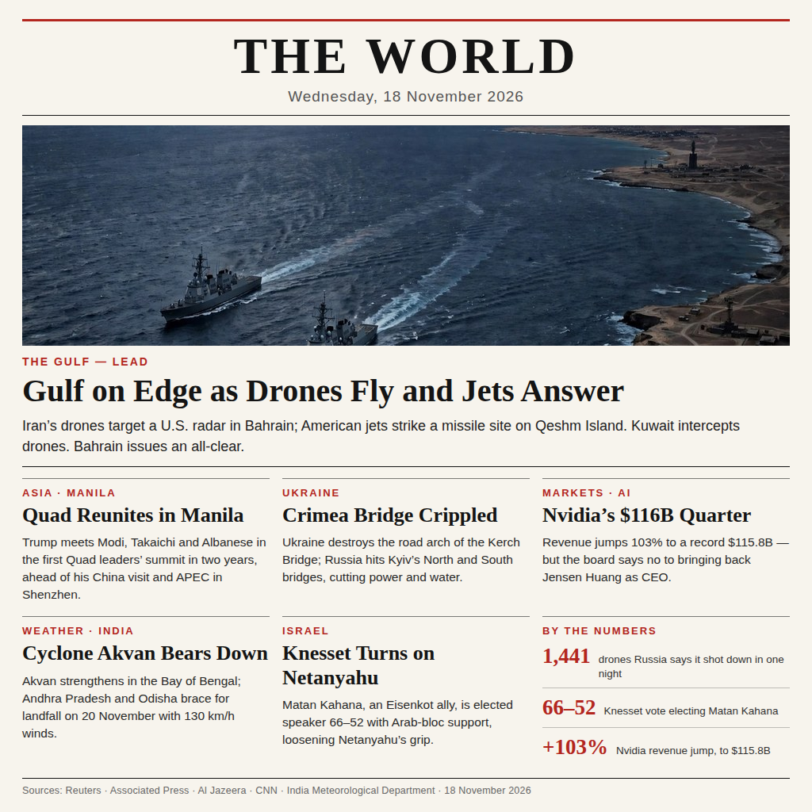

# The World — 18 November 2026

[](https://make.fun/bounty/news-image-20261118?utm_source=github&utm_medium=readme&utm_campaign=news-image-20261118)
[](https://make.fun/bounty/news-image-20261118/leaderboard?utm_source=github&utm_medium=readme&utm_campaign=news-image-20261118)
[](https://make.fun/bounty/news-image-20261118?utm_source=github&utm_medium=readme&utm_campaign=news-image-20261118)

An entry for make.fun **news-image-20261118**, "Sum up 18 November's world news in one image"
($250 in prizes, $50 to the winner, entries close 2026-11-20 07:00 WIB).
The bounty is at make.fun under news-image-20261118.

## What it is

One image — a newspaper front page, "THE WORLD", dated Wednesday, 18 November 2026 —
that sums up the day's world news in six stories. The judge has no news feed, so the
image carries the news itself: every headline and summary is printed on the page,
readable at a glance.



## The six stories

1. **The Gulf (lead).** Iran's drones target a U.S. radar in Bahrain; American jets
   strike a missile site on Qeshm Island. Kuwait intercepts drones. Bahrain issues
   an all-clear. (Reuters, Associated Press, Al Jazeera, U.S. Central Command)
2. **Quad reunites in Manila.** Trump meets Modi, Takaichi and Albanese in the first
   Quad leaders' summit in two years, ahead of his China visit and APEC in Shenzhen.
   (BusinessWorld, Associated Press)
3. **Crimea Bridge crippled.** Ukraine destroys the road arch of the Kerch Bridge;
   Russia hits Kyiv's North and South bridges, cutting power and water.
   (Reuters)
4. **Nvidia's $116B quarter.** Revenue jumps 103% to a record $115.8B — but the board
   says no to bringing back Jensen Huang as CEO. (Reuters, CNN)
5. **Cyclone Akvan bears down.** Akvan strengthens in the Bay of Bengal; Andhra Pradesh
   and Odisha brace for landfall on 20 November with 130 km/h winds.
   (India Meteorological Department)
6. **Knesset turns on Netanyahu.** Matan Kahana, an Eisenkot ally, is elected speaker
   66–52 with Arab-bloc support, loosening Netanyahu's grip. (Reuters, CNN, Al Jazeera)

By the numbers: 1,441 drones Russia says it shot down in one night · 66–52 Knesset
vote electing Matan Kahana · +103% Nvidia revenue jump, to $115.8B.

## How the image was made

A bento front-page layout (one large lead tile, five story tiles, one stat tile),
in a mono-hot newspaper style: warm paper, black ink, one hot-red accent, serif
display headlines with a clean sans body. The lead photograph — warships in the Gulf
at dusk — was generated for this entry; every headline and summary is typeset
programmatically, so the text is sharp and exactly as written. The finished image
is 1024×1024 PNG, under 1 MiB.

## The program

`main.py` (Python 3.13, standard library only) copies the `entry.png` beside it
to `/output/entry.png` — a byte-for-byte copy, no network, no randomness, so two
runs write the same bytes. Run it locally with:

```
mkdir -p out && MAKEFUN_OUTPUT_DIR=out python3 main.py
```

## Sources

Reuters · Associated Press · Al Jazeera · CNN · BusinessWorld · India Meteorological
Department — all stories as reported on 18 November 2026.

MIT — see `LICENSE`.
